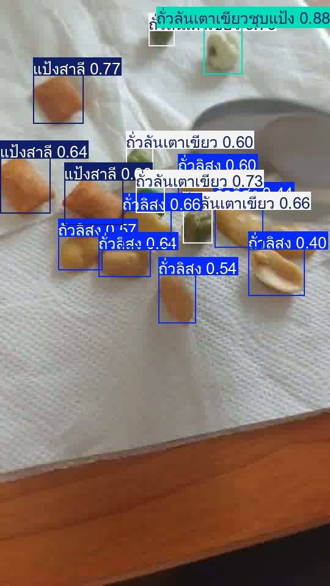
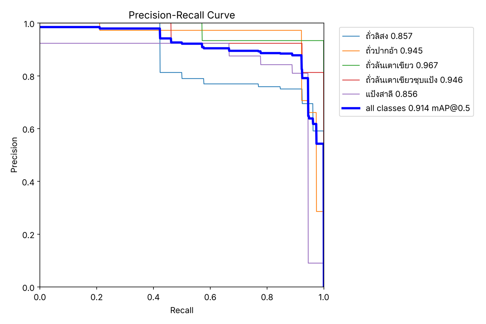
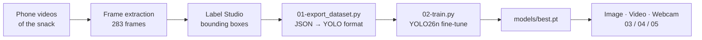

# Bean Snack Detection with YOLO

**A custom object-detection model that finds and classifies the 5 ingredients of a Thai mixed-bean snack in photos, video and live camera. It reaches 0.91 mAP@50 on held-out images, and I built the whole pipeline end to end: data collection, labelling, dataset tooling, training, evaluation and inference.**


<p align="center">
  
</p>

## Why

A mixed-bean snack is a blend of several ingredients, and checking the mix by eye is slow and inconsistent. A detector that counts each component per frame is the first building block for automated **composition checks** (for example, "too few peas in this batch") on a production line.

## Results

Evaluated on the 30-image validation split (109 labelled objects) that the model never trained on:

| Metric | Score |
|---|---|
| **mAP@50** | **0.914** |
| mAP@50-95 | 0.547 |
| Precision | 0.858 |
| Recall | 0.928 |
| CPU inference | ~120 ms / image (Intel Xeon, no GPU) |

| Class | Thai label | Train boxes | Val boxes | AP@50 |
|---|---|---:|---:|---:|
| Peanut | ถั่วลิสง | 227 | 26 | 0.857 |
| Broad bean | ถั่วปากอ้า | 167 | 38 | 0.945 |
| Green pea | ถั่วลันเตาเขียว | 80 | 14 | 0.967 |
| Battered green pea | ถั่วลันเตาเขียวชุบแป้ง | 86 | 13 | 0.946 |
| Wheat cracker | แป้งสาลี | 109 | 18 | 0.856 |

<p align="center"></p>

**What the numbers say.** The pea classes are easiest because their colour is distinctive. Peanuts and wheat crackers are the weakest: both are beige and similar in size, so the next round of data collection should target those two.

## Pipeline



The export step is defensive by design, because bad labels silently ruin a detector:

- **Validates every box.** It rejects rotated boxes and boxes outside the image, and clamps floating-point edge noise.
- **De-duplicates** frames that were labelled twice and keeps a single annotation per image.
- **Reproducible split.** The 80/20 train/val split uses a fixed seed and is checked so that no image appears in both sets.
- **Class-coverage check.** It fails if any class is missing from train or val, and prints per-class box counts to expose imbalance.
- **Non-destructive.** An existing dataset is backed up, never overwritten.

Training fine-tunes the pretrained **YOLO26n** (2.4 M parameters) for up to 100 epochs with early stopping. Augmentation (rotation, shear, perspective, horizontal and vertical flips, light mosaic/mixup) suits a top-down camera where the snack can lie in any orientation.

## Run it

```bash
git clone https://github.com/tawan230666/yolo-bean-detection.git
cd yolo-bean-detection
python -m venv .venv && source .venv/bin/activate
pip install -r requirements.txt
```

| Task | Command |
|---|---|
| Detect in an image | `python 03-test_image.py path/to/photo.jpg` |
| Detect in a video | `python 04-test_video.py video/road3.mp4` |
| Live webcam (press `q` to quit) | `python 05-test-camera.py` |
| Rebuild the dataset from labels | `python 01-export_dataset.py` |
| Retrain | `python 02-train.py` (auto-selects CUDA, Apple Silicon or CPU) |
| Evaluate | `yolo val model=models/best.pt data=dataset/data.yaml` |

Annotated results are written to `runs/detect/`.

## Repository layout

```
01-export_dataset.py   Label Studio JSON → YOLO dataset (validated, reproducible split)
02-train.py            Fine-tune YOLO26n, keep the best checkpoint in models/
03-test_image.py       Inference on one image
04-test_video.py       Inference on a video file (streamed frame by frame)
05-test-camera.py      Real-time webcam inference with OpenCV
dataset/               149 labelled images (119 train / 30 val) + data.yaml
frame/                 Raw extracted frames
models/best.pt         Trained weights
project-4.json         Label Studio export (source of truth for labels)
video/                 Test videos
```

## Next steps

- Collect more peanut and cracker samples, using hard-example mining from false positives
- Export to ONNX / CoreML and benchmark on-device speed
- Add a counting overlay that reports the ingredient ratio per frame

---

**Author:** Tawan Tiphkun ([@tawan230666](https://github.com/tawan230666)), Software Engineering, RMUTL Chiang Mai
